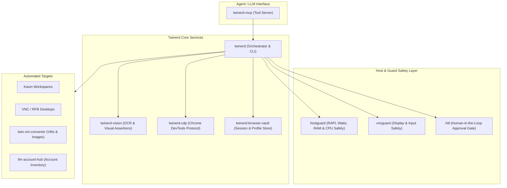

# Twinerd — Desktop, KVM & Machine Automation Framework

**Twinerd** to kompleksowy ekosystem automatyzacji pulpitu, maszyn wirtualnych, środowisk kontenerowych (Kasm, Docker) oraz bezpiecznego sterowania interfejsem graficznym za pośrednictwem protokołów **RFB/VNC**, **CDP** oraz interfejsu narzędziowego **MCP (Model Context Protocol)**.

---

## Architektura Systemu

---

## Katalog Repozytoriów

### 1. Interfejs MCP i Narzędzia Agenta
* [twinerd-mcp](https://github.com/twinerd/twinerd-mcp) — Pełny serwer narzędziowy MCP (`desktop_observe`, `desktop_click`, `keyboard_press`, `desktop_guarded_action`, `pelorus_benchmark_run`).
* [twinerd-agent](https://github.com/twinerd/twinerd-agent) — Autonomiczny agent wykonawczy zadań pulpitowych.
* [twinerd-flow](https://github.com/twinerd/twinerd-flow) — Reaktywny silnik przepływów zdarzeń pulpitowych.

### 2. Narzędzia Pulpitu, Wizji i Przeglądarki
* [twinerd-vision](https://github.com/twinerd/twinerd-vision) — Analiza bufora ekranowego, OCR (Tesseract) oraz asercje wizualne.
* [twinerd-cdp](https://github.com/twinerd/twinerd-cdp) — Sterowanie przeglądarką przez Chrome DevTools Protocol.
* [twinerd-browser-vault](https://github.com/twinerd/twinerd-browser-vault) — Zarządzanie ciasteczkami, sesjami i profilami przeglądarek.
* [twinerd-arranger](https://github.com/twinerd/twinerd-arranger) — Zarządzanie układem okien i przestrzenią roboczą (EWMH).

### 3. Bezpieczeństwo Hosta, Nadzór i HITL
* [hostguard](https://github.com/twinerd/hostguard) — Strażnik zasobów fizycznych węzła (CPU, RAM, energia RAPL watts, auto-kill procesów zbiegłych).
* [vncguard](https://github.com/twinerd/vncguard) — Strażnik sesji graficznych i transmisji VNC.
* [hitl](https://github.com/twinerd/hitl) — Bramka zatwierdzania akcji ryzykownych z udziałem człowieka.

### 4. Wirtualizacja, Maszyny i Konta
* [twin-vm-converter](https://github.com/twinerd/twin-vm-converter) — Konwersja obrazów dysków i maszyn wirtualnych.
* [desktop-clonerd-com](https://github.com/twinerd/desktop-clonerd-com) — Środowiska pulpitowe w chmurze i integracja z Kasm.
* [vnclone](https://github.com/twinerd/vnclone) — Szybkie klonowanie i migawkowanie sesji VNC.
* [llm-account-hub](https://github.com/twinerd/llm-account-hub) — Zarządzanie kontami, tożsamościami i credentialami agentów.
* [llm-account-inventory](https://github.com/twinerd/llm-account-inventory) — Inwentaryzacja i status kont LLM.

---

## Zgodność ze Standardami
Repozytoria ekosystemu Twinerd podlegają ciągłej walidacji za pomocą frameworka [Wellmanifest/wellman](https://github.com/wellmanifest/wellman), gwarantując pełną powtarzalność, izolację gałęzi `wellmanifest/worktrees` oraz weryfikację Test-Driven Auto-Merge (`wellmanifest/merge`).
